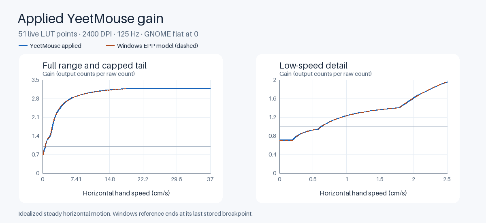

# MouseBridge

Recreate Windows Enhance Pointer Precision (EPP) on Ubuntu running GNOME on Wayland with YeetMouse. MouseBridge reads the Windows registry curve, plots the modeled gain, and generates a YeetMouse profile.

## Workflow


Install from the project directory in a virtual environment with Python 3.10 or later. The `tui` extra adds the interactive preview, and the `plot` extra adds PNG export.

```sh
python -m pip install ".[tui,plot]"
mousebridge tui
```

1. **Capture on Windows.** Choose **Read Windows registry** in Windows Terminal. Enter the active mouse DPI, Windows display scaling, and polling rate. Then confirm that EPP is on under **Additional mouse settings > Pointer Options**. Save the capture as `windows-mouse.json`. To estimate the polling rate, move the mouse in circles for a few seconds and record the **Likely rate** in Hz. [Mouse Polling Rate Test](https://webcammictest.com/mouse/polling-rate/)
2. **Preview and export.** Choose **Load snapshot** in the TUI on Windows or Linux. Use **Preview Windows curves** to see Windows pointer speed and EPP gain, or **Preview gain curves** to compare Windows and YeetMouse. Use **Save YeetMouse profile** to generate `yeetmouse-epp.conf` or **Export Windows curves PNG** to save `windows-curves.png`. Profile generation runs offline on either platform.
3. **Try the profile on Linux.** Install and load YeetMouse using its upstream instructions. Use the same mouse, DPI preset, and polling rate as on Windows. In the directory containing the generated profile, record your current GNOME settings and save your current YeetMouse configuration under a new filename before applying the profile. [YeetMouse installation](https://github.com/AndyFilter/YeetMouse#installation--uninstallation)

```sh
schema=org.gnome.desktop.peripherals.mouse
previous_profile=$(gsettings get "$schema" accel-profile)
previous_speed=$(gsettings get "$schema" speed)
printf 'Previous profile %s, previous speed %s\n' "$previous_profile" "$previous_speed"
yeetmousectl save yeetmouse-before-epp.conf
gsettings set "$schema" accel-profile flat
gsettings set "$schema" speed 0
yeetmousectl apply yeetmouse-epp.conf
yeetmousectl dump
```

Check for `accelMode=AccelMode_Lut` in the dump. If the trial feels right, copy the profile to the file YeetMouse loads at boot. The command backs up the previous boot configuration. [Restore the previous settings](docs/baseline.md#restore-the-settings-after-a-trial)

```sh
sudo cp --backup=numbered -- yeetmouse-epp.conf /etc/yeetmouse.conf
```

For CLI use, run `mousebridge --help`. The main commands are `export`, `yeetmouse-curve`, and `plot-wincurves`. The [saved baseline and calibration notes](docs/baseline.md) include the captured values, GNOME comparison, and libinput alternatives.

## Curve functions

The registry values `SmoothMouseXCurve` and `SmoothMouseYCurve` each contain five little-endian 16.16 fixed-point coordinates. Each coordinate takes up eight bytes. Divide each entry by 65,536, pair the X and Y values, and interpolate linearly between the resulting points to define `f(x)`.

The EPP model uses Windows display scaling `P` in percent, pointer sensitivity `S`, and raw report deltas `dx` and `dy`.

```text
D = 96 × P / 100
A = (max(D, 96) / 120) × (S / 10)
r = max(|dx|, |dy|) + min(|dx|, |dy|) / 2
Windows gain(r) ≈ A × f(r / 3.5) / r, for r > 0
```

For steady horizontal motion at `v` cm/s, use mouse DPI `C` and polling rate `H` in Hz.

```text
Raw counts per report ≈ v × C / (2.54 × H)
Pointer speed (px/s)  ≈ H × A × f(r / 3.5)
YeetMouse input (counts/ms) ≈ v × C / 2540
```

The YeetMouse lookup table samples the Windows **gain** at those input speeds. YeetMouse interpolates between samples and holds the last gain above the final Windows breakpoint. At zero input, the curve uses its low-speed gain limit, and pointer speed is zero.

## Referenced repositories

- [Windows Pointer Linux](https://github.com/junaga/windows-pointer-linux/blob/main/docs/research/windows-11.md) documents the Windows 11 EPP algorithm used for the model.
- [YeetMouse](https://github.com/AndyFilter/YeetMouse) applies the gain lookup table on Linux. The profile was tested with [version 0.9.5 at commit `78dcd0d`](https://github.com/AndyFilter/YeetMouse/tree/78dcd0d573bedd5dd7b9e29e9162b28c9eb2fd7b).
- [GNOME desktop schemas](https://github.com/GNOME/gsettings-desktop-schemas/blob/main/schemas/org.gnome.desktop.peripherals.gschema.xml.in) define the desktop acceleration settings used in the comparison.
- [maccel](https://github.com/Gnarus-G/maccel) was evaluated as a Linux acceleration driver during development.

## Result

The applied YeetMouse gain closely follows the modeled Windows EPP curve through the final registry breakpoint. The two panels show the full range and the low-speed detail.


