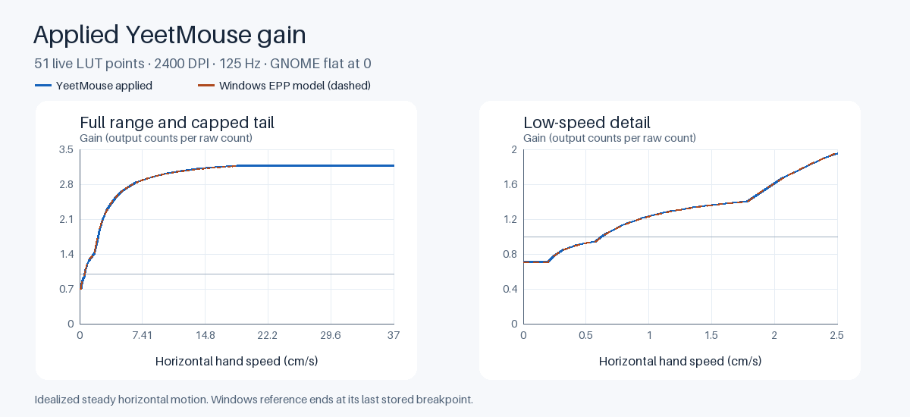

# Saved baseline and calibration

[Back to the MouseBridge workflow](../README.md)

## Captured settings

Enhance pointer precision (EPP) was enabled in Windows for the saved [Windows snapshot](../windows-mouse.json), which records `MouseSensitivity=10` and `MouseSpeed=1`. The EPP checkbox state was confirmed separately. The export captures the registry settings and curve bytes.

The saved [GNOME snapshot](../ubuntu-mouse.json) uses GNOME Wayland with speed `0.2` and the `flat` profile. For this pair of snapshots, the comparison suggests testing `adaptive` at `0.2` as a starting point for measuring pointer travel.

## Saved Windows EPP curve

The saved Windows build is `10.0.26200`. The model uses the reported setup of **125% display scaling**, **pointer speed 10/20**, **2400 DPI**, and **125 Hz**.

Each registry curve value contains five 8-byte little-endian entries. Divide each entry by 65,536 to decode its 16.16 fixed-point coordinate, then pair X and Y entries by index. The registry function `f(x)` linearly interpolates between these points.

| Registry X | Registry Y | Modeled horizontal hand speed (cm/s) | Modeled gain (pointer px/raw count) |
| ---: | ---: | ---: | ---: |
| 0 | 0 | 0 | 0.7111 (low-speed limit) |
| 0.430007935 | 1.070266724 | 0.1991 | 0.7111 |
| 1.25 | 4.140625 | 0.5788 | 0.9464 |
| 3.860000610 | 18.984375 | 1.7873 | 1.4052 |
| 40 | 443.75 | 18.5208 | 3.1696 |

The published Windows 11 analysis scales the registry X coordinates by 3.5 and the Y coordinates by `(max(D, 96) / 120) × (S / 10)`, where `D` is the effective DPI of the display region containing the cursor and `S` is the Windows pointer-speed setting. At 125% scaling and speed 10/20, `D = 120` and the Y factor is 1. For each nonzero report, the model uses `r = max(|dx|, |dy|) + min(|dx|, |dy|) / 2` raw counts and gives a steady gain of approximately `f(r / 3.5) / r`. [Windows 11 reverse-engineering notes](https://github.com/junaga/windows-pointer-linux/blob/main/docs/research/windows-11.md)

For steady horizontal motion at hand speed `v` in cm/s, with evenly spaced reports:

```text
Raw counts per report ≈ (2400 / 2.54 / 125) × v ≈ 7.559055 × v
Pointer speed (px/s)  ≈ 125 × f(2.159730 × v)
Gain (px/raw count)   ≈ f(2.159730 × v) / (7.559055 × v), for v > 0
```

Pointer speed is zero at rest. The modeled gain crosses **1 px/count at 4.7500 counts per report**, equivalent to **0.6284 cm/s** under these assumptions. The endpoint at **18.5208 cm/s** is the last stored breakpoint.

The values and crossover were checked against the saved bytes. The published analysis audited builds `26100.3194` and `28000.2525`. A cursor trace from build `26200` is still needed to validate the model on this setup. Integer report counts, fixed-point rounding, subpixel remainders, and one-report gain blending when entering a higher segment can affect individual swipes.

## Recheck the Windows baseline

1. Confirm **Enhance pointer precision** is checked under **Additional mouse settings > Pointer Options**.
2. Confirm **125% display scaling** on the monitor used for testing and **2400 DPI / 125 Hz** in the active mouse profile.
3. Export to a fresh file with `python mousebridge.py export -o windows-mouse-verification.json`. Compare the build, `MouseSensitivity`, `MouseSpeed`, and both curve blobs with the original snapshot.

## Compare the saved snapshots

Run the earlier offline comparison from the repository root:

```sh
python3 mousebridge.py analyze windows-mouse.json --gnome ubuntu-mouse.json
```

Omit `--gnome ubuntu-mouse.json` to read settings from the current GNOME Wayland session. To keep a new reference, run `python3 mousebridge.py snapshot -o gnome-new.json`.

- The Windows export reads `HKCU\Control Panel\Mouse`. It records `MouseSensitivity` (pointer speed setting), `MouseSpeed` (acceleration flag), both thresholds, and the exact `SmoothMouseXCurve` and `SmoothMouseYCurve` bytes as hex. Missing or unusable values appear as JSON null. This is a registry snapshot of the current user's stored preferences.
- The GNOME snapshot reads `speed` and `accel-profile` from `org.gnome.desktop.peripherals.mouse`. These are desktop settings. A device may use its default profile when the configured one is unsupported. See the [GNOME schema](https://github.com/GNOME/gsettings-desktop-schemas/blob/master/schemas/org.gnome.desktop.peripherals.gschema.xml.in#L111-L132).
- The report keeps the current GNOME speed as a baseline. Its profile heuristic suggests testing `flat` for `MouseSpeed=0`, `adaptive` for `1` or `2`, and retaining the current profile for any other value. Verify the Windows checkbox before interpreting the hint. GNOME flat applies a constant device-specific factor. Adaptive responds to movement speed. Differences in gain and curve shape require measurement. See the [libinput profile documentation](https://wayland.freedesktop.org/libinput/doc/1.29.0/pointer-acceleration.html).

## Generate a libinput custom curve

```sh
python3 mousebridge.py libinput-curve windows-mouse.json --display-scale 125 --polling-rate 125 -o libinput-curve.json
```

The command previews a GNOME custom motion curve as JSON with `pointer-step` and `pointer-speeds`. It models the Windows EPP-on behavior for the same mouse, DPI preset, and polling rate on both systems. At 125 Hz, motion at `u` raw counts/ms corresponds to about `8 × u` counts per Windows report. For this baseline, the target output speed is `f(8 × u / 3.5) / 8`. The table samples through the last change in slope and includes one more sample so libinput can extrapolate the final segment. Compare measured cursor travel to calibrate the effect of compositor display scaling and event timing. [libinput custom profile documentation](https://wayland.freedesktop.org/libinput/doc/1.29.0/pointer-acceleration.html#the-custom-acceleration-profile)

Check `gsettings range org.gnome.desktop.peripherals.mouse accel-profile` and `gsettings list-keys org.gnome.desktop.peripherals.mouse` before planning to use the preview. GNOME needs both the `custom` profile and the `custom-accel-config` key. The Ubuntu GNOME 50.1 session checked for this baseline exposes `default`, `flat`, and `adaptive`. The command generates the preview offline and makes no desktop changes. [Upstream GNOME mouse schema](https://github.com/GNOME/gsettings-desktop-schemas/blob/main/schemas/org.gnome.desktop.peripherals.gschema.xml.in)

## Try GNOME's built-in adaptive profile

On GNOME Wayland, try **adaptive** at speed **+0.15** to see whether the built-in profile feels close enough for everyday use. This was the closest modeled fit for the saved Windows EPP baseline over **0.1–18.52 cm/s**, weighting equal intervals on the logarithmic speed axis equally. The fit assumes the same **2400 DPI** mouse preset and the **1000 DPI** fallback libinput uses when the device has no `MOUSE_DPI` property. Other devices and setups may need a different setting. [libinput 1.31.1 adaptive profile source](https://chromium.googlesource.com/external/gitlab.freedesktop.org/libinput/libinput/+/refs/tags/upstream/1.31.1/src/filter-mouse.c)

From a terminal in your GNOME Wayland session, save your current values and apply the trial setting:

```sh
schema=org.gnome.desktop.peripherals.mouse
previous_profile=$(gsettings get "$schema" accel-profile)
previous_speed=$(gsettings get "$schema" speed)
printf 'Previous profile %s, previous speed %s\n' "$previous_profile" "$previous_speed"
gsettings set "$schema" accel-profile adaptive
gsettings set "$schema" speed 0.15
```

Try slow adjustments, ordinary movements, and quick swipes. The model predicts higher gain than Windows at **1–2 cm/s** and lower gain on fast swipes. For example, at **1 cm/s** the modeled gains are **1.71** for GNOME and **1.23** for Windows. At **10 cm/s** they are **2.23** and **3.01**, respectively. These figures compare motion per raw count before GNOME display scaling. Desktop cursor travel was not measured.

To restore your previous values, run this in the same terminal:

```sh
gsettings set "$schema" accel-profile "$previous_profile"
gsettings set "$schema" speed "$previous_speed"
```

## YeetMouse result

The generated YeetMouse configuration uses 51 lookup-table points. Its modeled gain stayed within 0.64% of the Windows EPP model on a 10,000-speed sample through the last stored breakpoint. Beyond 18.52 cm/s, the table holds the gain at 3.1696. The active driver settings matched the generated configuration, and the user reported a close match to Windows in use. The overlay uses steady horizontal motion and the driver lookup table. Report timing, diagonal motion, and compositor display scaling can affect actual cursor travel.



### Restore the settings after a trial

Reapply the saved YeetMouse runtime configuration and restore the GNOME profile and speed you recorded before the trial:

```sh
yeetmousectl apply yeetmouse-before-epp.conf
gsettings set "$schema" accel-profile "$previous_profile"
gsettings set "$schema" speed "$previous_speed"
```

YeetMouse reads `/etc/yeetmouse.conf` at boot. The runtime trial leaves that file in place.
